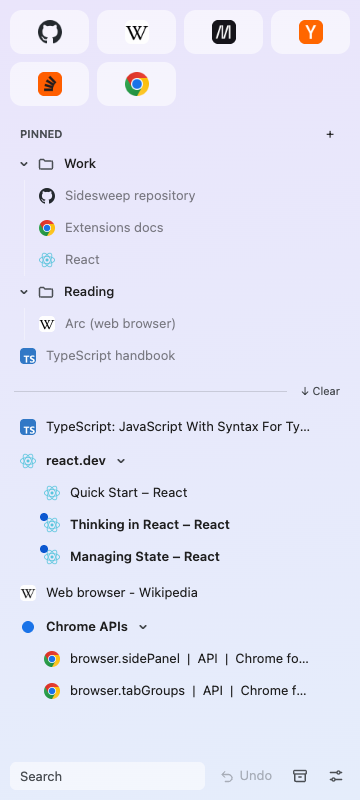
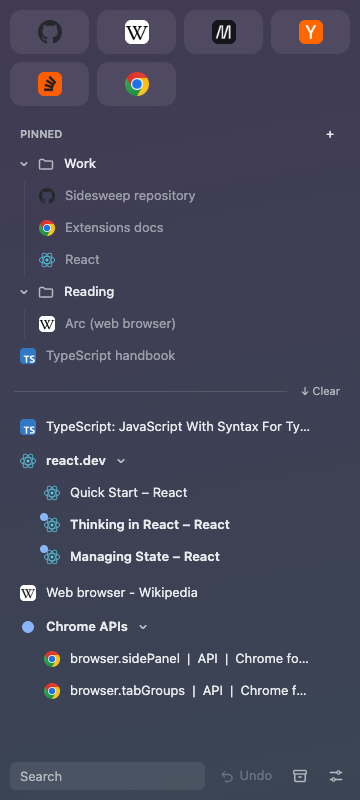
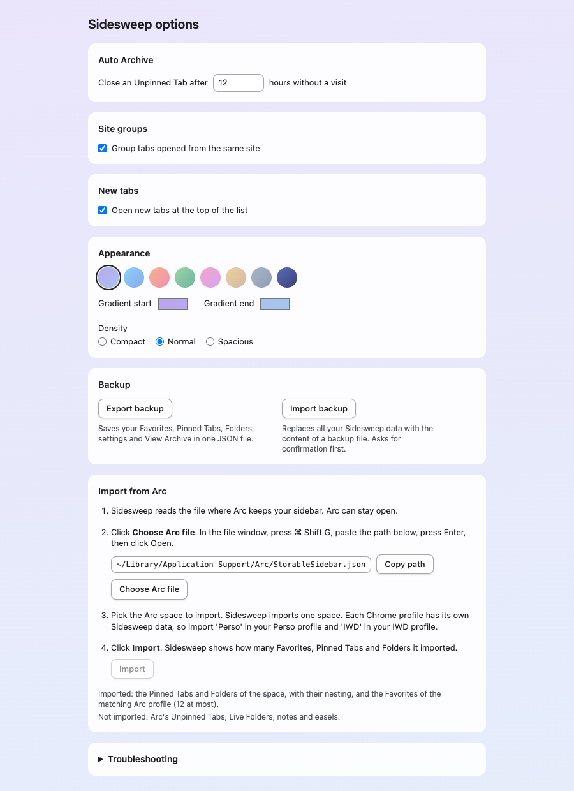

# Sidesweep

Sidesweep is a Chrome extension that brings the sidebar of the Arc browser to Chrome. It shows one vertical list in the Chrome side panel. The list mixes saved links with open tabs, as Arc does. Sidesweep is for people who leave Arc for Chrome and want to keep their sidebar.

> **Status:** early version. Sidesweep is not on the Chrome Web Store. To use it, build it from source (see [Install](#install)).

  
  &nbsp;
  

## Features

Sidesweep uses the words of Arc. [docs/design-decisions.md](docs/design-decisions.md) and [GLOSSARY.md](GLOSSARY.md) define each term in full.

- **Favorites.** A Favorite is a saved link that shows as a large icon at the top of the panel. A profile has 12 Favorites at most.
- **Pinned Tabs and Folders.** A Pinned Tab is a saved link in a tree under the Favorites. A Folder holds Pinned Tabs and other Folders.
- **Live tabs.** Each Favorite or Pinned Tab opens one real Chrome tab, its live tab. After a navigation, the Reset button sends the live tab back to the saved URL.
- **Today.** The Unpinned Tabs section, also called Today, lists the open tabs of all windows that are not live tabs. The order is the order of the Chrome tab strip.
- **Tab groups and Site groups.** The panel shows Chrome tab groups as blocks that you can collapse. It also groups tabs that opened from one another on the same site. Chrome does not see these Site groups.
- **Tab Handoff.** A click on a tab of another window moves the tab into your current window. The tab does not reload, so a form that you started keeps its content.
- **Link guard.** In a live tab, a link to another host opens in a new tab. The live tab stays on its site.
- **Auto Archive.** Sidesweep closes an Unpinned Tab that nobody viewed for 12 hours. You can change the delay. The tab on screen and a tab that plays sound never close.
- **View Archive.** This list keeps the tabs that Auto Archive closed, for 30 days. You can search it and reopen a tab.
- **Search, multi-select and drag and drop.** The search field filters every section. Ctrl or Cmd and Shift clicks select several rows. You can drag rows between the sections.
- **Undo.** The Undo button reverts the last 20 changes, one at a time.
- **Import from Arc and backup.** Sidesweep imports one Arc space. The options page exports and imports your data as a JSON file.
- **Appearance.** The panel has a background gradient of two colours and three densities. It follows the light or dark mode of your system.

## Requirements

- Chrome 141 or later.
- Node.js and npm, for the build.

## Install

1. Clone this repository.
2. Run `npm install`.
3. Run `npm run build`. The build writes the extension to `.output/chrome-mv3`.
4. Open `chrome://extensions` in Chrome.
5. Turn on **Developer mode** in the top-right corner.
6. Click **Load unpacked** and select the folder `.output/chrome-mv3`.

To open the panel, click the Sidesweep icon in the toolbar or press `Alt+Shift+S`. Chrome asks for this click or key press once in each window.

## Import from Arc

Arc keeps its sidebar in a file named `StorableSidebar.json`. Open the Sidesweep options page and go to the **Import from Arc** section. A numbered guide there tells you where the file is and how to select it.

The import replaces your Favorites, Pinned Tabs and Folders. It keeps your settings and View Archive. The Undo button reverts the import.

## Keyboard shortcuts

| Keys                    | Action                                                 |
| ----------------------- | ------------------------------------------------------ |
| `Alt+Shift+S`           | Opens the Sidesweep panel.                             |
| `Alt+Shift+P`           | Pins the current tab at the root of the Pinned Tabs.   |
| `Ctrl+Z` or `Cmd+Z`     | Undoes the last change, while the panel has the focus. |
| `Delete` or `Backspace` | Closes the selected rows.                              |
| `Escape`                | Ends the selection.                                    |

To change the first two shortcuts, open `chrome://extensions/shortcuts`.

## Options

Right-click the Sidesweep icon and choose **Options**. The options page holds these settings:

- **Auto Archive**: the delay in hours before Sidesweep closes an Unpinned Tab.
- **Site groups**: the switch "Group tabs opened from the same site". It is on by default.
- **New tabs**: the switch "Open new tabs at the top of the list". It is on by default.
- **Appearance**: the gradient colours, with presets, and the density.
- **Backup**: the export and import of a JSON file.
- **Import from Arc**: the import of one Arc space. This section comes first while Sidesweep is empty.
- **Troubleshooting**: a log of how Sidesweep placed the last new tabs, with a copy button.

  

## Permissions and privacy

Sidesweep asks Chrome for these permissions:

| Permission          | Why Sidesweep needs it                                                           |
| ------------------- | -------------------------------------------------------------------------------- |
| `sidePanel`         | Shows the panel in the Chrome side panel.                                        |
| `tabs`              | Lists, opens, moves and closes tabs, and reads their titles and URLs.            |
| `tabGroups`         | Shows Chrome tab groups, and moves or collapses them.                            |
| `storage`           | Keeps your Favorites, Pinned Tabs, Folders, settings and View Archive.           |
| `alarms`            | Runs Auto Archive on a timer.                                                    |
| `favicon`           | Shows site icons from the Chrome icon cache.                                     |
| Access to all sites | A small script in each page checks link clicks in live tabs, for the link guard. |

Your data stays on your computer, in the extension storage of Chrome. Sidesweep sends no network request and collects no usage data. Your data does not sync between computers, so use the JSON export as a backup. [PRIVACY.md](PRIVACY.md) is the full privacy policy.

## Known limits

Chrome sets these limits. No extension can remove them.

- The horizontal tab strip of Chrome stays visible.
- The side panel opens only after a click or a shortcut, once in each window.
- You choose the side and the width of the panel in Chrome.
- The panel colour cannot follow the colour of the Chrome profile theme.

Sidesweep does not copy every Arc feature. Spaces, Live Folders and Peek are out of scope. Each Chrome profile has its own Sidesweep data, so use one profile for each Arc space.

## Development

[docs/design-decisions.md](docs/design-decisions.md) records the design decisions, with the terms it uses.

### Commands

Install once with `npm install`. Use npm, not pnpm.

| Command                | What it does                                                      |
| ---------------------- | ----------------------------------------------------------------- |
| `npm run build`        | Builds the extension into `.output/chrome-mv3`.                   |
| `npm run dev`          | Starts the WXT dev server.                                        |
| `npm run lint`         | Runs the Biome linter.                                            |
| `npm run format`       | Formats and fixes the code with Biome.                            |
| `npm run format:check` | Checks the format without changing a file.                        |
| `npm run typecheck`    | Checks the types with TypeScript.                                 |
| `npm test`             | Runs the unit and component tests with Vitest.                    |
| `npm run test:e2e`     | Builds the extension, then runs the Playwright tests in Chromium. |

The first end-to-end test is the Tab Handoff gate (`tests/e2e/00-tab-handoff-gate.spec.ts`). It checks that `chrome.tabs.move` moves a tab to another window without a reload.

### Layout

- `src/background/modules/`: one file per service worker module. Each file default-exports a `WorkerModule`. The folder is loaded by a glob, so a new file starts by itself.
- `src/shared/protocol.ts` and `src/shared/types.ts`: the commands, messages and data types that the worker and its views share.
- `src/panel/sections/` and `src/options/sections/`: one component per section of the page.
- `tests/support/fake-chrome.ts`: a fake of the Chrome tabs, windows, tab group, side panel and port APIs for unit tests.
- Unit tests sit next to the code (`*.test.ts`). End-to-end tests live in `tests/e2e/`.

## License

Copyright (C) 2026 Damien Gustave

Sidesweep is free software: you can redistribute it and/or modify it under the terms of the GNU General Public License as published by the Free Software Foundation, either version 3 of the License, or (at your option) any later version. The SPDX identifier of this license is `GPL-3.0-or-later`.

Sidesweep is distributed in the hope that it will be useful, but WITHOUT ANY WARRANTY; without even the implied warranty of MERCHANTABILITY or FITNESS FOR A PARTICULAR PURPOSE. See [LICENSE](LICENSE) for the full text.

### Name and icon

Additional term under section 7(e) of the GNU GPL version 3: this license grants no right to use the name "Sidesweep" or the Sidesweep icon. A modified version that you distribute must use another name and another icon.

### Third-party code

The built extension bundles packages under the MIT and Apache-2.0 licenses. The build writes their notices to `THIRD_PARTY_LICENSES.md` at the root of the extension folder.
